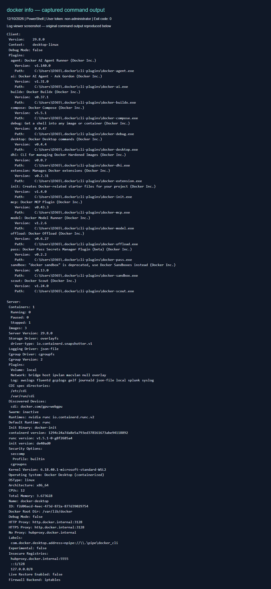

# Báo cáo kỹ thuật: Container và Virtual Machine

## 1. Bối cảnh và kiến trúc

Ngày thực hành: **12/10/2026**, múi giờ Asia/Saigon. Mục tiêu là đánh giá việc chuyển ứng dụng từ mô hình quản trị từng VPS sang đóng gói và triển khai bằng Docker.

VM ảo hóa phần cứng qua hypervisor; mỗi máy ảo chạy hệ điều hành khách và kernel riêng. Container Linux là nhóm tiến trình được cô lập, dùng chung kernel của môi trường Linux chạy chúng. Image container mang ứng dụng và thư viện cần thiết, không phải một kernel khách riêng. Vì vậy không nên hiểu namespaces là tạo ra nhiều kernel độc lập. [Docker: Container và VM](https://docs.docker.com/get-started/docker-concepts/the-basics/what-is-a-container/).

Sơ đồ các lớp:

```text
VM:        Phần cứng -> Hypervisor -> Guest OS/kernel -> Thư viện -> Ứng dụng
Container: Phần cứng -> Linux kernel -> Container runtime -> Tiến trình + thư viện
```

Trên máy thực hành, Docker Desktop dùng WSL 2. Container chia sẻ kernel Linux của môi trường này, không chạy trực tiếp trên kernel Windows. VPS cũng có thể là nơi cài Docker: chuyển sang container thường thay đổi cách triển khai ứng dụng, không nhất thiết loại bỏ VM bên dưới.

## 2. Bảng so sánh theo năm tiêu chí

| Tiêu chí | VM / Hypervisor | Container / Docker |
| --- | --- | --- |
| Dung lượng image | Chứa hệ điều hành khách, thường lớn hơn | Chứa ứng dụng và user space cần thiết, thường nhỏ hơn; ứng dụng lớn vẫn có thể tạo image lớn |
| Thời gian khởi động | Cần khởi động guest OS và dịch vụ | Chủ yếu khởi tạo tiến trình; thường nhanh hơn khi image đã có sẵn |
| Hao phí OS | Mỗi VM duy trì kernel và dịch vụ hệ điều hành riêng | Chia sẻ kernel, giảm phần OS lặp lại; runtime và môi trường Docker Desktop vẫn tiêu tốn tài nguyên |
| Mức độ cô lập | Ranh giới kernel riêng và hypervisor | Chia sẻ kernel, phụ thuộc namespaces, quyền và cấu hình bảo mật |
| Khả năng mở rộng | Nhân bản cả VM, thường cần nhiều tài nguyên hơn | Dễ tăng số instance ứng dụng; cần cơ chế điều phối, mạng và cân bằng tải |

Đây là so sánh định tính dựa trên kiến trúc, không phải kết quả benchmark của máy này. Tốc độ còn phụ thuộc tải image, ổ đĩa và thời gian ứng dụng sẵn sàng. Không có một kích thước hay thời gian khởi động cố định áp dụng cho mọi VM và container.

## 3. Namespaces: giới hạn phạm vi nhìn thấy

Namespaces cung cấp các góc nhìn riêng về tài nguyên kernel:

- **PID / Process:** tách không gian mã tiến trình; tiến trình có thể mang PID khác nhau ở các namespace. Tiến trình đầu tiên trong PID namespace có vai trò PID 1. Host vẫn có thể quan sát tiến trình container.
- **Network:** tách giao diện mạng, bảng định tuyến và không gian cổng. Hai container có thể cùng nghe cổng 80 bên trong; muốn truy cập từ host cần cấu hình mạng hoặc publish port.
- **Mount:** tách danh sách điểm gắn filesystem. Container có cây mount riêng; bind mount hoặc volume được cấu hình vẫn có thể chia sẻ dữ liệu.

Cơ chế này cô lập góc nhìn của tiến trình chứ không tạo kernel riêng. Xem [Linux namespaces](https://man7.org/linux/man-pages/man7/namespaces.7.html).

## 4. Control Groups: quản lý CPU và RAM

Cgroups gom tiến trình thành nhóm để đo lường và kiểm soát tài nguyên. Với cgroup v2, CPU controller có quota theo chu kỳ qua `cpu.max`, còn `cpu.weight` quy định trọng số tương đối khi tranh chấp CPU. Memory controller dùng `memory.max` làm giới hạn cứng; khi không thể thu hồi đủ bộ nhớ, cơ chế OOM trong cgroup có thể kết thúc tiến trình. [Tài liệu Linux cgroup v2](https://docs.kernel.org/admin-guide/cgroup-v2.html).

Ví dụ cấu hình, chỉ minh họa và không thuộc các lệnh đã thực thi trong bài:

```bash
docker run --cpus=1.5 --memory=512m nginx:alpine
```

`--cpus=1.5` đặt hạn mức thời gian CPU tương đương 1,5 CPU, không có nghĩa dành riêng 1,5 lõi vật lý. `--memory=512m` đặt hạn mức bộ nhớ; swap còn phụ thuộc cấu hình riêng. Docker mặc định không đặt hạn mức CPU/RAM cụ thể cho từng container, nên cần cấu hình để giảm tình trạng một dịch vụ chiếm tài nguyên của dịch vụ khác. [Docker resource constraints](https://docs.docker.com/engine/containers/resource_constraints/).

Namespaces trả lời “tiến trình nhìn thấy những gì”; cgroups trả lời “nhóm tiến trình được dùng bao nhiêu tài nguyên”. Hai cơ chế bổ sung cho nhau, nhưng không tự tạo thành ranh giới bảo mật tương đương kernel riêng.

## 5. Đánh giá chuyển từ VPS sang Docker

Theo phân tích của báo cáo, doanh nghiệp có thể giảm công sức cài đặt thủ công bằng cách đóng gói phiên bản ứng dụng và phụ thuộc trong image. Một bản build được kiểm thử rồi triển khai nhất quán giúp giảm sai lệch môi trường. Việc tăng số bản sao hoặc quay về image trước cũng thuận tiện hơn khi quy trình phát hành được chuẩn hóa.

Lợi ích chỉ đạt được khi thiết kế vận hành phù hợp: tách cấu hình khỏi image, lưu dữ liệu bền vững trong volume hoặc dịch vụ lưu trữ, có sao lưu, log và giám sát. Docker Engine đơn lẻ không tự bảo đảm cân bằng tải hoặc khả năng chịu lỗi nhiều máy. Hệ thống cần kernel riêng, workload ít tin cậy hoặc yêu cầu cô lập mạnh có thể tiếp tục dùng VM; triển khai container bên trong VM là phương án kết hợp hợp lý. Vì vậy quyết định chuyển đổi nên dựa trên ứng dụng và chi phí vận hành thực tế.

## 6. Thực hành và trích xuất docker info

Hai lệnh kiểm tra đã chạy trực tiếp trong PowerShell, không gõ `sudo`:

```powershell
docker version
docker info
```

User: `DESKTOP-0H70HJK\D365`. Kiểm tra token bằng WindowsPrincipal cho kết quả `Administrator = False`. Cả hai lệnh trả mã thoát **0**. Lần thử ban đầu daemon chưa chạy; đã dùng `docker desktop start` rồi chạy lại thành công. Không thay đổi quyền tài khoản.

Các giá trị dưới đây trích từ phần Server của log vừa thu, không lấy lại số liệu bài cũ:

| Thông số | Giá trị thực tế |
| --- | --- |
| Server Version | 29.8.0 |
| Cgroup Driver | cgroupfs |
| Cgroup Version | 2 |
| Containers | 1 |
| Running / Paused / Stopped | 0 / 0 / 1 |
| Images | 3 |

`Cgroup Driver` là cách daemon quản lý cgroups; không đồng nghĩa với phiên bản cgroups. Ở đây driver là `cgroupfs`, phiên bản là `2`. `Containers` tính cả container đã dừng; số liệu phản ánh đúng thời điểm kiểm tra.

Lệnh lọc tương đương gợi ý đề bài trên PowerShell:

```powershell
docker info | Select-String -Pattern 'cgroup' -CaseSensitive:$false
```

### Ảnh log



Ảnh chụp trang hiển thị nguyên văn đầu ra đã lưu của lệnh `docker info`; không phải ảnh cửa sổ Terminal. Công cụ chụp cửa sổ không khởi tạo được nên dùng trang xem log để giữ đầy đủ nội dung. Log gốc được đính kèm bên dưới để đối chiếu.

### Đầu ra docker version

```text
Client:
 Version:           29.8.0
 API version:       1.56
 Go version:        go1.26.8
 Git commit:        88096ef
 Built:             Thu Sep  3 21:53:38 2026
 OS/Arch:           windows/amd64
 Context:           desktop-linux

Server: Docker Desktop 4.92.0 (240144)
 Engine:
  Version:          29.8.0
  API version:      1.56 (minimum version 1.40)
  Go version:       go1.26.8
  Git commit:       3ce5872
  Built:            Thu Sep  3 21:51:20 2026
  OS/Arch:          linux/amd64
  Experimental:     false
 containerd:
  Version:          v2.3.5
  GitCommit:        1294c24a7da8e5a793ed378161673abe94118892
 runc:
  Version:          1.5.1
  GitCommit:        v1.5.1-0-g8f2685a4
 docker-init:
  Version:          0.19.0
  GitCommit:        de40ad0
```

### Đầu ra docker info

```text
Client:
 Version:    29.8.0
 Context:    desktop-linux
 Debug Mode: false
 Plugins:
  agent: Docker AI Agent Runner (Docker Inc.)
    Version:  v1.140.0
    Path:     C:\Users\D365\.docker\cli-plugins\docker-agent.exe
  ai: Docker AI Agent - Ask Gordon (Docker Inc.)
    Version:  v1.31.0
    Path:     C:\Users\D365\.docker\cli-plugins\docker-ai.exe
  buildx: Docker Buildx (Docker Inc.)
    Version:  v0.37.1
    Path:     C:\Users\D365\.docker\cli-plugins\docker-buildx.exe
  compose: Docker Compose (Docker Inc.)
    Version:  v5.5.1
    Path:     C:\Users\D365\.docker\cli-plugins\docker-compose.exe
  debug: Get a shell into any image or container (Docker Inc.)
    Version:  0.0.47
    Path:     C:\Users\D365\.docker\cli-plugins\docker-debug.exe
  desktop: Docker Desktop commands (Docker Inc.)
    Version:  v0.4.4
    Path:     C:\Users\D365\.docker\cli-plugins\docker-desktop.exe
  dhi: CLI for managing Docker Hardened Images (Docker Inc.)
    Version:  v0.0.7
    Path:     C:\Users\D365\.docker\cli-plugins\docker-dhi.exe
  extension: Manages Docker extensions (Docker Inc.)
    Version:  v0.2.31
    Path:     C:\Users\D365\.docker\cli-plugins\docker-extension.exe
  init: Creates Docker-related starter files for your project (Docker Inc.)
    Version:  v1.4.0
    Path:     C:\Users\D365\.docker\cli-plugins\docker-init.exe
  mcp: Docker MCP Plugin (Docker Inc.)
    Version:  v0.43.3
    Path:     C:\Users\D365\.docker\cli-plugins\docker-mcp.exe
  model: Docker Model Runner (Docker Inc.)
    Version:  v1.2.6
    Path:     C:\Users\D365\.docker\cli-plugins\docker-model.exe
  offload: Docker Offload (Docker Inc.)
    Version:  v0.6.27
    Path:     C:\Users\D365\.docker\cli-plugins\docker-offload.exe
  pass: Docker Pass Secrets Manager Plugin (beta) (Docker Inc.)
    Version:  v0.2.2
    Path:     C:\Users\D365\.docker\cli-plugins\docker-pass.exe
  sandbox: "docker sandbox" is deprecated, use Docker Sandboxes instead (Docker Inc.)
    Version:  v0.13.0
    Path:     C:\Users\D365\.docker\cli-plugins\docker-sandbox.exe
  scout: Docker Scout (Docker Inc.)
    Version:  v1.24.0
    Path:     C:\Users\D365\.docker\cli-plugins\docker-scout.exe

Server:
 Containers: 1
  Running: 0
  Paused: 0
  Stopped: 1
 Images: 3
 Server Version: 29.8.0
 Storage Driver: overlayfs
  driver-type: io.containerd.snapshotter.v1
 Logging Driver: json-file
 Cgroup Driver: cgroupfs
 Cgroup Version: 2
 Plugins:
  Volume: local
  Network: bridge host ipvlan macvlan null overlay
  Log: awslogs fluentd gcplogs gelf journald json-file local splunk syslog
 CDI spec directories:
  /etc/cdi
  /var/run/cdi
 Discovered Devices:
  cdi: docker.com/gpu=webgpu
 Swarm: inactive
 Runtimes: nvidia runc io.containerd.runc.v2
 Default Runtime: runc
 Init Binary: docker-init
 containerd version: 1294c24a7da8e5a793ed378161673abe94118892
 runc version: v1.5.1-0-g8f2685a4
 init version: de40ad0
 Security Options:
  seccomp
   Profile: builtin
  cgroupns
 Kernel Version: 6.18.40.1-microsoft-standard-WSL2
 Operating System: Docker Desktop (containerized)
 OSType: linux
 Architecture: x86_64
 CPUs: 12
 Total Memory: 3.673GiB
 Name: docker-desktop
 ID: f2d06acd-4eec-473d-872a-877d39029754
 Docker Root Dir: /var/lib/docker
 Debug Mode: false
 HTTP Proxy: http.docker.internal:3128
 HTTPS Proxy: http.docker.internal:3128
 No Proxy: hubproxy.docker.internal
 Labels:
  com.docker.desktop.address=npipe://\\.\pipe\docker_cli
 Experimental: false
 Insecure Registries:
  hubproxy.docker.internal:5555
  ::1/128
  127.0.0.0/8
 Live Restore Enabled: false
 Firewall Backend: iptables
```
